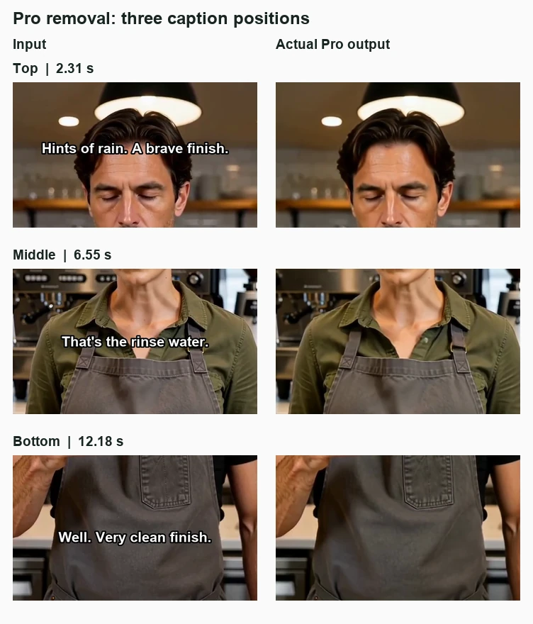

# When captions change position

The first line sits across a man's forehead. The next is over the barista's apron; the last is near the bottom of the shot. A fixed bottom box would miss the first two. This 15-second practice clip lets you see what full-frame Pro does at each position before you use your own footage.

[Download the captioned input MP4](https://raw.githubusercontent.com/JollyToday/GhostCut-auto_video_translation/main/examples/full-frame-removal/input.mp4) · [Download the actual Pro output MP4](https://raw.githubusercontent.com/JollyToday/GhostCut-auto_video_translation/main/examples/full-frame-removal/pro-output.mp4)

Play both files and pause at the times shown above. Each pair is cropped around the same part of the shot, with both frames displayed at the same width. The input is 540 × 960, and the downloaded result is 536 × 960; both contain AAC audio. The output is the file returned by one sponsored full-frame Pro run, with no retouching. A clean reference from the Creator Kit was used to make the input, not shown as the output.

**Try it yourself:** download the input and run the free [n8n form](../n8n/), [Dify workflow](../dify/), [Node-RED flow](../node-red/) or [agent skill](../../plugins/weydub/skills/pro-subtitle-removal/SKILL.md) without a Weydub key. To use your own Weydub credits, import the [Make full-frame Pro blueprint](../../integrations/make/#remove-subtitles-anywhere-in-the-frame-with-pro) or follow the account-based instructions in the Dify or Node-RED guide. Watching or downloading the two sample files does not start a job.

Choose [the area selector in Weydub](https://weydub.com/subtitle-removal/) when prices, signs or other text must stay. This example shows three fixed caption positions across successive shots; it does not test captions sliding continuously through a frame.

*Source: “Wrong Cup,” a fictional [Weydub Creator Kit](https://weydub.com/creator-kit/) scene. The three English cues retain their original timing and dialogue; only their placement was changed. [Sample usage terms](https://weydub.com/creator-kit/usage.txt).*
