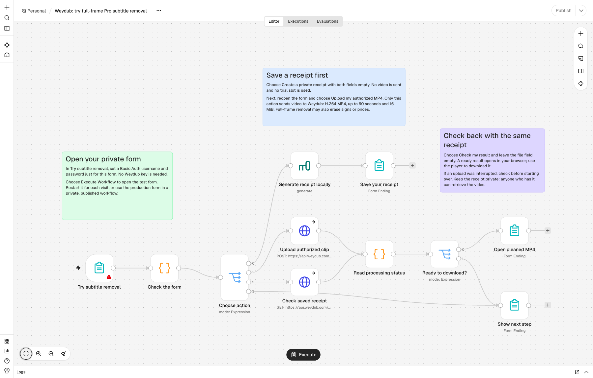

# Try subtitle removal in n8n

Have a finished video with captions baked into the picture? Upload one short clip from your computer and open the cleaned MP4 when it is ready. This workflow uses built-in n8n nodes. It does not require a community node, a Weydub key or a payment method.

**See the effect first:** the [15-second Wrong Cup example](../full-frame-removal/) puts captions at the top, middle and bottom in different shots. It includes the input, the actual Pro output and matching frames. Full-frame Pro may also remove signs, prices or other lettering. [Select a smaller area in Weydub](https://weydub.com/subtitle-removal/) when that text needs to stay.

## Open the form

1. Download the [workflow JSON](https://raw.githubusercontent.com/JollyToday/GhostCut-auto_video_translation/main/examples/n8n/free-pro-subtitle-removal.json). In your private n8n workspace, open a blank workflow and choose **Import from File**.
2. Open **Try subtitle removal**. Under **Basic Auth**, create or select a username and password for **your n8n form**. These stay with n8n. Do not enter your Weydub or n8n account password here.
3. Click **Execute Workflow** and open the test form. For another form submission in test mode, start the workflow again. A team running a private published copy can reopen its **Production URL** instead.

The red indicator on **Try subtitle removal** in this fresh import means the form's Basic Auth credential has not been selected yet.

## Clean your clip

| In the form | What to do |
|---|---|
| **Create a private receipt** | Leave both other fields empty. Copy the 64-character receipt somewhere private. No clip is sent and no slot is used. |
| **Upload my authorized MP4** | Paste the receipt, select your H.264 MP4 (up to 60 seconds and 16 MiB; AAC audio or no audio) and click **Continue**. This sends the clip to Weydub. |
| **Check my result** | Paste the same receipt and leave the file field empty. While the clip is processing, check again later. When ready, the form opens the cleaned MP4; use the browser player's download control or **Save Video As**. |

If the upload is interrupted, check the receipt first. Resending identical bytes with that receipt resumes the same job; using a new receipt can spend another slot. Anyone holding the receipt can retrieve the result. Keep it, the file and the private download link out of shared logs and chat.

All anonymous integrations share 100 sponsored submissions per UTC month. If capacity runs out, the form stops without charging you. Need longer videos or routine batch work? Use the [Weydub n8n node with your own credits](../../integrations/n8n/) or the [Weydub editor](https://weydub.com/subtitle-removal/).
