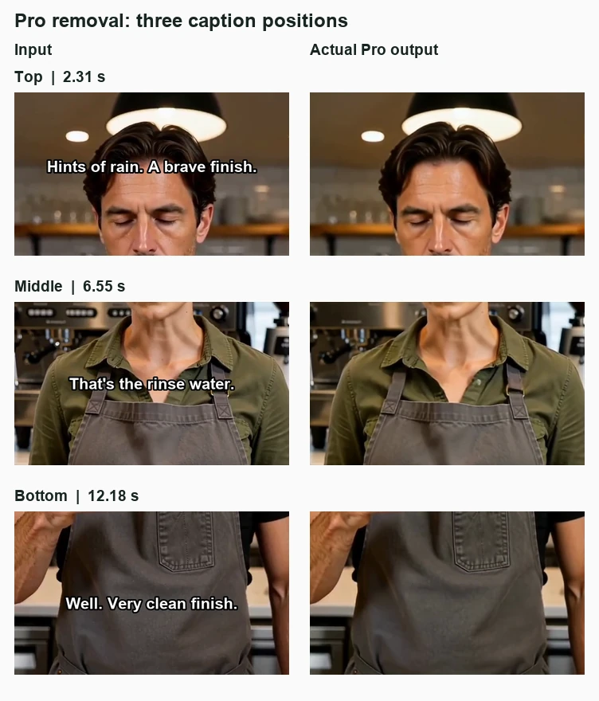

# Weydub Media Localization Lab

Have a clip with subtitles baked into the picture? [Open the lab](https://huggingface.co/spaces/iniu/weydub-media-localization), choose **Remove subtitles** and try your own short MP4 without a Weydub key. You can also preview OCR, dubbing and image translation, or connect a private copy to your own [Weydub](https://weydub.com/) account.

**See what Pro removes before uploading.** In this 15-second scene, the caption starts over a forehead, moves to an apron after a cut, then appears near the bottom. Compare the [captioned MP4](https://raw.githubusercontent.com/JollyToday/GhostCut-auto_video_translation/c4d72c4/examples/full-frame-removal/input.mp4) with the [actual Pro output](https://raw.githubusercontent.com/JollyToday/GhostCut-auto_video_translation/c4d72c4/examples/full-frame-removal/pro-output.mp4). Pause at **2.31 s**, **6.55 s** and **12.18 s**, or look at the [paired frames and sample terms](https://github.com/JollyToday/GhostCut-auto_video_translation/tree/c4d72c4/examples/full-frame-removal). Viewing the example uses no trial slot.

| Operation | Input | Output |
| --- | --- | --- |
| Remove subtitles (Pro) | Video with burned-in text anywhere in the picture; no box or language selection needed | Cleaned MP4. Full-frame detection can also remove signs, labels or prices; use the [Weydub editor](https://weydub.com/subtitle-removal/) for selective removal. |
| Extract subtitles | Video with visible text, plus the language on screen | Timed SRT from full-frame OCR |
| Dub video | Video with speech you have permission to translate, spoken and target languages | Video with translated speech and captions |
| Translate image | Downloadable image URL, visible and target languages | Translated image with the wording rendered back into the picture |

**Try full-frame Pro on a short clip:** in the original Weydub Space or local build, select **Remove subtitles**, choose an H.264 MP4 (up to 60 seconds and 16 MiB, optional AAC audio), confirm permission and select **Remove subtitles** below the file. Choosing the file alone does not upload it. After confirmation the Space relays the bytes to Weydub. Select **Check status** to get the cleaned MP4. A private receipt stays in the tab across reloads; copy it before closing the tab if you need to return later. Anyone with that receipt can retrieve the result. Retry the same file with the same receipt after a connection failure. The trial draws on 100 sponsored jobs per UTC month shared across anonymous channels. It never switches to paid processing.

**Preview without uploading:** paste a direct HTTPS link and click **Preview request** to inspect the settings, or select **Translate image** to preview the sample Chinese product poster. Neither preview fetches your source or spends credits. The dubbing clip is a published product demo; the downloadable example SRT illustrates the output format.

**Use your own processing credits:** duplicate the Space into your **personal** Hugging Face account and select **Private** visibility. In the duplicate's Settings, add `WEYDUB_APP_KEY` and `WEYDUB_APP_SECRET` as *Secrets*, and set the variable `WEYDUB_ENABLE_LIVE` to `1`. Sign in with the same Hugging Face account that owns the duplicate. The supplied code does not accept credentials from a web form. Paid controls are disabled in the original public Space and when native Hugging Face OAuth is unavailable. Your personal duplicate does not offer the public sponsored upload.

Each click on **Submit one file** requests one billable Weydub task. Full-frame Pro uses the Pro rate on your Weydub account. The app signs requests on the server; it does not include the App Secret in a request to the processing API. Save the job ID and use **Get result** to check progress without starting another task. When it finishes, open the download link and save the file. If a finished job is locked for insufficient credits, top up and check the same ID. [Processing prices](https://weydub.com/vip/pricing-detail/) · [API guide](https://weydub.com/docs/api/).

**Repository build:** from the GitHub repository root run `node integrations/huggingface/stage.mjs /path/to/new-empty-directory`. The command includes only listed public files and the existing Python integration contract. From the staged directory run `python -m pip install -r requirements.txt` and `python app.py`. Preview is offline; confirming a sponsored upload uses the live shared allowance. This build is what should be pushed to a Space repository.

**Create your own Space from the release:** download `weydub-space.zip` from the [Weydub Space release](https://github.com/JollyToday/GhostCut-auto_video_translation/releases/tag/weydub-space-v1.2.0) and unzip it. In your Hugging Face account create a private **Gradio** Space using **CPU Basic**. Upload the extracted files together at the repository root so `app.py` is beside `README.md`. Start with **Preview request**, then configure your credentials as described above to process a file.
